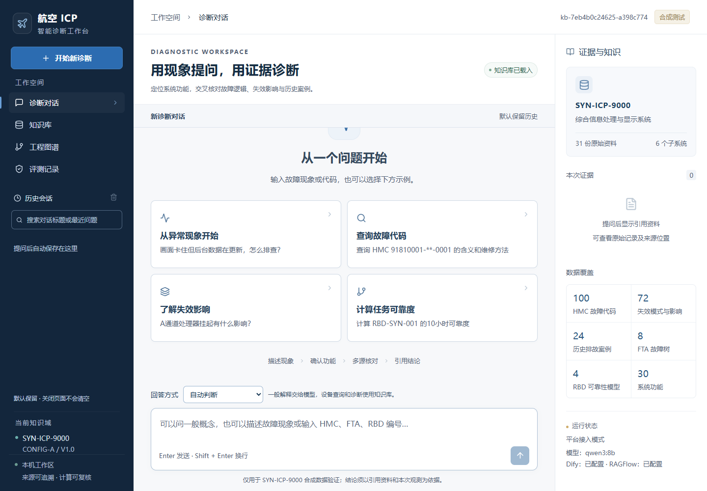
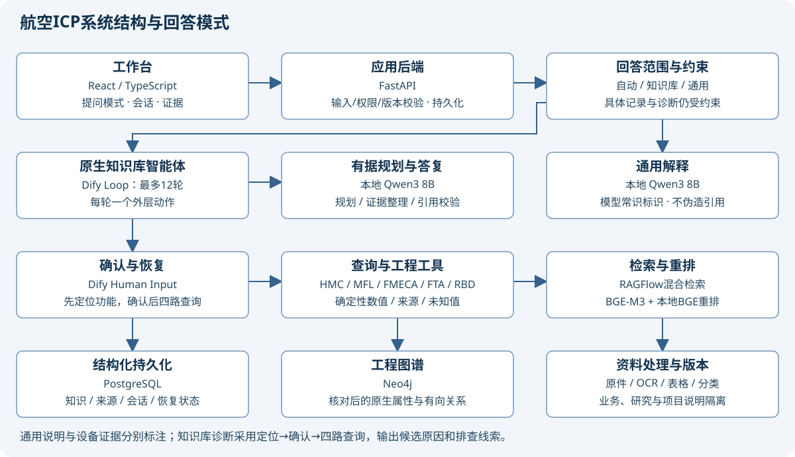

# Aviation ICP Diagnostic Assistant

航空知识问答与故障诊断 Agent 平台。将本地 LLM、检索增强生成、工作流编排和确定性工程计算结合，用自然语言查询资料、定位候选功能并生成带来源的辅助诊断结果。



## 技术栈

| 层次 | 实现 |
| --- | --- |
| 前端 | React、TypeScript、Vite |
| API 与业务服务 | Python、FastAPI、SQLAlchemy |
| 本地模型 | Qwen3 8B、Ollama |
| Agent 编排 | Dify 原生循环、结构化 JSON 工具决策、人工确认 |
| 知识检索 | RAGFlow、BGE-M3、本地 BGE 重排 |
| 数据存储 | PostgreSQL、Neo4j；本地开发支持 SQLite |
| 部署与验证 | Docker Compose、pytest、浏览器验证脚本 |

## Agent 设计

1. 识别问题范围，区分通用解释、知识查询与故障辅助诊断。
2. LLM 结合问题和已有观察生成单步 JSON 决策，后端校验工具名、参数和资料范围。
3. 执行工具并回传观察，检查缺参、重复动作、错误及结束条件；外层循环上限为 12 步。
4. 诊断流程先检索三个功能候选，经用户确认后并行查询 FTA、FMECA、RBD 和历史案例。
5. 服务端保存任务和工作流状态，支持确认后恢复、会话重载与执行摘要查看。

公开执行摘要记录工具、状态与证据，不输出模型内部思维链。四路查询属于工作流中的并行工具分支。

## 功能

- 文档解析、表格抽取、OCR 补充、资料分类和知识版本管理。
- 关键词与向量混合检索、重排、来源引用及原始页定位。
- 十个逻辑工具：混合检索、功能定位、健康管理编码、维修清单、失效影响、故障树、可靠性模型、历史案例、综合诊断和结束动作。
- 工程算法计算可靠度、故障树概率与最小割集，返回参数、单位及适用假设。
- 历史会话搜索、重命名、删除、导出，以及诊断报告导出。
- 参数校验、确认去重、暂停恢复、有界重试与异常状态保留。

## 系统结构



React 工作台通过 FastAPI 管理会话和任务。Dify 负责流程编排，RAGFlow 提供检索，PostgreSQL 保存业务数据，Neo4j 保存工程图谱。工程数值由后端算法计算，LLM 负责规划与语言表达。

## 目录

```text
backend/icp/      API、Agent、检索、工具、工程计算与持久化
frontend/        工作台页面与会话、证据组件
deploy/          Compose、Dockerfile 与无凭据工作流模板
prompts/         Agent 提示词
scripts/         初始化、平台集成及验证脚本
tests/           单元与边界用例源码
eval/            固定自然语言评测定义
docs/            结构图、界面截图和运行说明
```

## 构建与运行条件

前端可独立安装依赖并构建：

```powershell
cd frontend
npm ci
npm run build
```

完整服务需要 Python 3.12、本地模型、Docker Linux 容器环境，以及对应的业务知识数据。原始文档、生成索引、运行会话、模型权重和私人配置不随本仓库分发；本仓库尚未提供可独立启动完整业务的演示知识包。查看代码、结构图和截图不需要这些运行依赖。

初始化、数据依赖与服务启动见[运行说明](docs/部署运行手册.md)。启动后工作台默认地址为 `http://127.0.0.1:8000/`；GitHub 源码仓库本身不提供在线诊断服务。

## 验证范围

不依赖业务资料的受控传输与资源调度测试可单独运行；本次公开目录检查为 9 项通过：

```powershell
.\.venv\Scripts\python.exe -m pytest -q tests/test_retry_budget.py tests/test_model_slot.py tests/test_fault_transport.py
```

这些测试使用模拟传输，不启动真实模型或平台。公开目录的前端依赖安装、TypeScript 检查和生产构建已通过。

完整业务环境记录了 344 项单元测试通过。固定自然语言评测完整批次为 119/120，修正后边界子集为 16/16；两次结果分别记录，不能合并称为一次完整批次全通过。

已完成本机隔离环境部署与备份恢复验证，未完成异机验证。原始测试运行依赖对应知识数据，公开仓库不包含完整运行证据和业务语料，因此不承诺仅克隆此仓库即可复现全部历史测试。

系统用于合成业务场景下的辅助诊断，不连接真实航空设备；结果应结合引用资料和当前观测核对。
